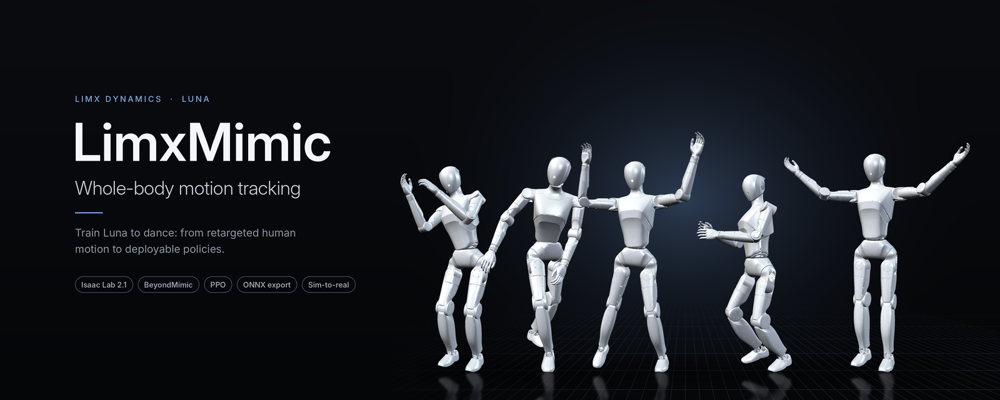
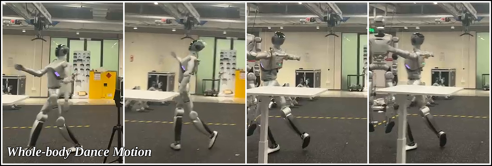

<div align="center">



[English](README.md) | **中文**

[](https://docs.omniverse.nvidia.com/isaacsim/latest/overview.html)
[](https://isaac-sim.github.io/IsaacLab)
[](https://docs.python.org/3/whatsnew/3.10.html)
[](https://releases.ubuntu.com/22.04/)
[](LICENCE)
[](LICENSES/Apache-2.0.txt)
[](https://github.com/limxdynamics/luna-description)

</div>

# LimxMimic — Luna (HU_L04) 动作跟踪

Luna（HU_L04）人形机器人的动作跟踪训练，基于
[BeyondMimic](https://beyondmimic.github.io/)
（[论文](https://arxiv.org/abs/2508.08241)、[视频](https://youtu.be/RS_MtKVIAzY)）。

**适用范围**：Luna 闭链模型，任务变体固定为 `Tracking-Flat-HU-L04-Parallel-Deploy-Gravity-v0`。
动作重定向本身、训练平台的任务提交不在范围内；公开包不包含其他机型或训练任务。

## 亮点

- **BeyondMimic 的 Luna 适配版。** 在 Isaac Lab 上为 27 自由度的 Luna 人形机器人做全身动作跟踪，使用 PPO 训练。
- **闭链连杆自动处理。** 每段动作都会自动转换：求解脚踝和腰部连杆，映射到 51 自由度的闭链训练布局，并在训练开始前做正运动学校验。
- **一个 `.npy` 贯穿训练到部署。** 训练、回放和导出都直接使用同一份重定向后的动作文件。
- **导出即可部署。** 生成 `policy.onnx`（141 维观测、27 维动作）、50 Hz 参考轨迹和完整的 `param.yaml`，并附带与部署配置交叉校验的脚本。
- **开箱即可跑通全流程。** 随仓附带一段 22.9 秒、由 LimX Dynamics 采集的舞蹈动作。

## 流程

```text
retargeted motion.npy  (27 DoF, 50 Hz)
        │
        │  prepared automatically: solve ankle + waist linkages ─► 51-DoF closed-loop layout
        │                          ─► hold final pose ─► forward-kinematics check
        ▼
  train.py   Isaac Lab + PPO ─────────────────────────► model.pt
        │
        ├──► play.py   replay the policy in Isaac Sim
        │
        ▼
  export_policy_and_reference.py ─► policy.onnx + reference.txt + param.yaml
```

## 文档导航

本文覆盖四件事：搭好训练环境、看懂仓库结构、知道哪些参数能调、把一份已重定向的 `.npy` 数据跑成可以
play 的策略。所有实际踩过的坑集中在[第五章](#5-注意事项)。

| 文档 | 内容 |
| --- | --- |
| [QuickStart.zh-CN.md](QuickStart.zh-CN.md) | 从重定向后的 `.npy` 到部署文件的最短路径 |
| [Install.md](Install.md) | 同一套安装流程更长、更逐步的记录 |
| [1. 环境安装](#1-环境安装) | 固定版本、安装前检查与 7 步安装 |
| [2. 仓库目录结构](#2-仓库目录结构) | 各部分代码的位置，以及改什么去哪里 |
| [3. 可调参数](#3-可调参数) | 哪些是固定的，哪些可以放心调 |
| [4. 从 npy 数据到 play](#4-从-npy-数据到-play) | 动作转换、训练、checkpoint 与收敛判断 |
| [5. 注意事项](#5-注意事项) | 实际踩过的坑及解决办法 |
| [SAFETY.md](SAFETY.md) | 真机使用前必须遵守的运行边界 |
| [motions/README.zh-CN.md](motions/README.zh-CN.md) | 随仓动作数据：格式、来源与许可 |

## 真机效果

<p align="center">
  
</p>

---

## 1. 环境安装

> **仅支持源码安装。** 本项目只支持源码 checkout 后执行
> `python -m pip install -e source/whole_body_tracking`。不支持构建、发布或安装
> wheel/sdist/PyPI 包。运行依赖源码树中的大型 HU_L04 资产，这些资产不会打进 wheel。

### 1.1 版本要求

版本组合相互绑定，不要单独升级其中任何一个。Isaac Sim 4.X 只支持 Python 3.10，Isaac Lab 2.1.0 在
`setup.py` 里固定了 `torch==2.5.1`。

| 组件 | 版本 |
| --- | --- |
| Ubuntu | 22.04.5 LTS |
| Python | 3.10.15 |
| PyTorch | 2.5.1+cu118 / torchvision 0.20.1+cu118 |
| Isaac Sim | 4.5.0.0（pip 安装） |
| Isaac Lab | v2.1.0（源码安装） |
| conda 环境名 | `limxmimic` |

### 1.2 安装前检查

```bash
lsb_release -a                    # Ubuntu 22.04.5 LTS
ldd --version | head -n 1         # 需要 GLIBC >= 2.35
dpkg -l build-essential cmake     # 缺失则 sudo apt install cmake build-essential
df -h /                           # 需预留 20 GB 以上
nvidia-smi                        # 驱动是否正常
```

Isaac Sim 的 pip 包要求 **GLIBC 2.35+**。Ubuntu 20.04 是 GLIBC 2.31，装不了 pip 版，只能改用二进制
安装方式。

### 1.3 安装步骤

七步，按顺序执行。**第 2 步的 setuptools 降级必须在装 Isaac Lab 之前完成**，原因见
[坑位二](#坑位二setuptools-移除-pkg_resources导致-isaaclab-核心包静默安装失败)。

```bash
# 1/7  创建环境并写入两个环境变量
conda create -n limxmimic python=3.10.15 -y
conda env config vars set PYTHONNOUSERSITE=1 -n limxmimic
conda env config vars set OMNI_KIT_ACCEPT_EULA=Y -n limxmimic
conda activate limxmimic
echo "$PYTHONNOUSERSITE $OMNI_KIT_ACCEPT_EULA"     # 应输出：1 Y

# 2/7  降级 setuptools
pip install --upgrade pip
pip install "setuptools==75.8.0" wheel
python -c "import pkg_resources; print('pkg_resources OK')"

# 3/7  PyTorch
pip install torch==2.5.1 torchvision==0.20.1 \
    --index-url https://download.pytorch.org/whl/cu118

# 4/7  Isaac Sim，约 4 GB 下载、13 GB 安装
pip install --no-cache-dir "isaacsim[all,extscache]==4.5.0" \
    --extra-index-url https://pypi.nvidia.com

# 5/7  Isaac Lab v2.1.0
git clone --branch v2.1.0 --depth 1 https://github.com/isaac-sim/IsaacLab.git IsaacLab-2.1.0
cd IsaacLab-2.1.0
echo "setuptools<81" > ~/isaaclab-build-constraints.txt
export TERM=xterm
export PIP_CONSTRAINT=~/isaaclab-build-constraints.txt
./isaaclab.sh --install
pip list | grep -i "^isaaclab"                     # 五个包必须全部存在

# 6/7  安装本仓库
cd /path/to/whole_body_tracking
python -m pip install -e source/whole_body_tracking

# 7/7  验证
cd /path/to/IsaacLab-2.1.0
python scripts/tutorials/00_sim/create_empty.py --headless
```

> **第 5 步最后那条 `pip list` 核对不能省。** `isaaclab.sh` 即使核心包安装失败也会返回成功。应看到
> `isaaclab`、`isaaclab_assets`、`isaaclab_mimic`、`isaaclab_rl`、`isaaclab_tasks` 共五个。

第 4 步会把 numpy 从 2.x 降到 1.26.4，属正常行为。

磁盘占用：conda 环境约 17 GB，Isaac Lab 浅克隆 90 MB，安装过程另需约 4 GB 临时空间。空间紧张可用
`pip cache purge` 清理。

`Install.md` 保留了同一套安装流程更详细的逐步记录。

---

## 2. 仓库目录结构

仓库分两大块：`source/` 是安装成 Python 包的训练代码，`scripts/` 是直接执行的命令行工具。改配置在
前者，跑流程用后者。

```
whole_body_tracking/
├── scripts/                         命令行工具，直接执行
│   ├── rsl_rl/
│   │   ├── train.py                 启动训练
│   │   ├── play.py                  回放策略，顺带导出 ONNX
│   │   └── cli_args.py              训练/回放的命令行参数
│   ├── prepare_motion.py            把下面四步串成一条命令
│   ├── solve_parallel_linkage.py    解闭链自由度
│   ├── npy_to_npz.py                重定向 npy 转训练用 npz
│   ├── append_motion_tail.py        给动作加保持终止姿态的尾帧
│   ├── verify_motion_npz.py         用正运动学校验 npz（硬门禁）
│   ├── linkage_quality.py           输出闭链求解的逐帧残差报告
│   ├── dump_articulation_order.py   打印模型的关节/刚体规范顺序
│   ├── replay_npz.py                在 Isaac Sim 里直接回放参考动作
│   ├── export_motion_policy.py      离线 ONNX 导出器的入口
│   ├── check_deploy_onnx.py         用部署侧配置交叉检查 ONNX metadata
│   └── verify_parallel_motor_convention.py   交叉检查电机方向与零位
│
├── source/whole_body_tracking/whole_body_tracking/
│   ├── tasks/tracking/
│   │   ├── tracking_env_cfg.py      奖励、终止、域随机化、观测的总配置
│   │   ├── mdp/
│   │   │   ├── commands.py          参考动作加载、误差计算、自适应采样
│   │   │   ├── rewards.py           奖励函数实现
│   │   │   ├── terminations.py      终止条件实现
│   │   │   ├── events.py            域随机化实现
│   │   │   └── observations.py      观测项实现
│   │   └── config/hu_l04/
│   │       ├── parallel_env_cfg.py  闭链变体的环境配置
│   │       └── agents/rsl_rl_ppo_cfg.py   PPO 超参与网络结构
│   ├── robots/hu_l04_parallel.py    执行器增益、armature、动作缩放
│   ├── assets/__init__.py           解析机器人描述子模块的路径
│   └── utils/exporter.py            ONNX 导出与元数据
│
├── robot_descriptions/luna-description/   子模块：HU_L04 的 USD、URDF、MJCF 与 mesh
├── motions/                         已重定向的 npy 参考动作
├── logs/rsl_rl/                     训练产物：checkpoint、TensorBoard、导出的 ONNX
├── tools/offline_onnx_exporter/     纯策略离线导出 + NPY 组合流水线
└── tests/                           scripts 与导出器的 pytest 测试
```

### 改东西该去哪个文件

| 想改什么 | 文件 |
| --- | --- |
| 奖励、终止阈值、域随机化 | `tasks/tracking/tracking_env_cfg.py` |
| 课程采样参数 | `tasks/tracking/mdp/commands.py` 的 `MotionCommandCfg` |
| 新增一个奖励函数 | `tasks/tracking/mdp/rewards.py`，再到 `RewardsCfg` 注册 |
| PPO 超参、网络宽度 | `config/hu_l04/agents/rsl_rl_ppo_cfg.py` |
| 执行器刚度阻尼 | `robots/hu_l04_parallel.py` |
| 观测项 | `config/hu_l04/parallel_env_cfg.py` — **但不要改**，原因见 [3.1](#31-红线观测项和动作项不能改) |

---

## 3. 可调参数

### 3.1 红线：观测项和动作项不能改

**不要增删或修改观测项，不要改动作维度。** 这不是风格问题，改了策略就没法部署。

| 项 | 为什么不能改 |
| --- | --- |
| **观测** | 每一项和顺序会写进导出 ONNX 的 metadata，下位机按固定布局拼装输入向量。多一项少一项或顺序变了，下位机拼出来的向量就对不上策略的期望 |
| **动作** | 27 维电机指令，每一维对应硬件上一个具体的电机槽位。改宽度或改顺序，力矩会发到错误的关节上 |

本文使用的变体 `Tracking-Flat-HU-L04-Parallel-Deploy-Gravity-v0`，观测 **141** 维、动作 **27** 维：

```
command(54) + base_ang_vel(3) + projected_gravity(3)
            + joint_pos(27) + joint_vel(27) + actions(27) = 141
```

名字里带 **Deploy** 表示已经把下位机拿不到的量全部剔除了——全局位置、需要状态估计的线速度、无传感器
的连杆自由度；带 **Gravity** 表示保留了 IMU 直接给出的重力方向，这是去掉状态估计后唯一还能直接反映
躯干倾斜的量。

### 3.2 奖励：可以增删改

最安全的调节旋钮，改了不影响部署接口。定义在 `tracking_env_cfg.py` 的 `RewardsCfg`。

| 奖励项 | 权重 | std | 调大的效果 |
| --- | --- | --- | --- |
| `motion_global_anchor_pos` | 0.5 | 0.3 | 躯干世界位置贴得更紧，牺牲局部姿态自由度 |
| `motion_global_anchor_ori` | 0.5 | 0.4 | 躯干朝向更准 |
| `motion_body_pos` | 1.0 | 0.3 | 四肢位置更准，动作像不像的主力项 |
| `motion_body_ori` | 1.0 | 0.4 | 四肢朝向更准 |
| `motion_body_lin_vel` | 1.0 | 1.0 | 速度节奏更贴，动作不拖沓 |
| `motion_body_ang_vel` | 1.0 | 3.14 | 转动节奏更贴 |
| `action_rate_l2` | −0.1 | — | 动作更平滑抖动更少，但响应变钝、快动作跟不上 |
| `joint_limit` | −10.0 | — | 更不敢靠近限位。参考动作本身要求贴限位时会和跟踪奖励打架 |
| `undesired_contacts` | −0.1 | — | 更不敢用脚和手以外的部位触地 |

> **std 往往比权重更好用。** 六个跟踪项都是 `exp(−error² / std²)` 形式，**std 调小等于要求更严**，
> 误差稍大奖励就掉到接近零；调大则容忍度高但梯度平缓。它直接定义了「多大的误差还算好」。

**加新项**：`rewards.py` 里有一个写好但没接进配置的 `feet_contact_time` 可作范例。写一个函数，再到
`RewardsCfg` 加一条 `RewTerm` 即可。

**删项要小心**：六个 `motion_*` 是任务本身的定义，删掉任何一个都会让策略失去对应维度的约束。真正可
按需去掉的是三个惩罚项。

### 3.3 终止条件

定义在 `TerminationsCfg`。这组参数经常被忽略，但影响往往比奖励权重更大——**因为它直接决定策略有没有
机会学完一个动作**。

| 终止项 | 默认阈值 | 含义 |
| --- | --- | --- |
| `time_out` | 10 s（500 步） | 正常结束，不是失败 |
| `anchor_pos` | 0.25 m | 躯干锚点**高度**偏离参考超过此值 |
| `anchor_ori` | 0.8 | 躯干倾斜与参考的偏差（重力投影 z 分量之差） |
| `ee_body_pos` | 0.25 m | 四个末端（双踝双腕）任一**高度**偏离参考超过此值 |

> **怎么判断阈值是否合适**：用 `阈值 ÷ 该末端峰值垂直速度` 估算容错窗口。末端峰值 2 m/s、阈值
> 0.25 m，则策略落后 0.125 秒就被判死。参考动作里有大幅抬腿、跳跃或起身时，这个窗口会窄到策略根本
> 没机会学会，表现为**完成率长期上不去、失败原因几乎全是 `ee_body_pos`**。这种情况放宽到 0.4–0.5 m
> 往往立竿见影。

### 3.4 域随机化

定义在 `EventCfg`。加大随机化等于策略更鲁棒、更好迁移实机，代价是训练更慢、仿真里跟踪精度更低。

| 参数 | 默认值 | 作用 |
| --- | --- | --- |
| `physics_material` 静摩擦 | 0.3 – 1.6 | 地面摩擦范围。实机易打滑时保证下界足够低 |
| `physics_material` 动摩擦 | 0.3 – 1.2 | 同上 |
| `physics_material` 弹性 | 0.0 – 0.5 | 触地回弹 |
| `add_joint_default_pos` | ±0.01 rad | 关节零位标定误差 |
| `base_com` | x ±0.025 m，y/z ±0.05 m | 躯干质心不确定性，对平衡影响显著 |
| `push_robot` 间隔 | 1 – 3 s | 推力扰动频率 |
| `push_robot` 速度 | xy ±0.5 m/s，yaw ±0.78 rad/s | 扰动强度。调大提升抗扰，但精细动作会被推乱 |

### 3.5 课程采样

定义在 `MotionCommandCfg`。训练时每次复位从动作的哪一秒开始，由失败率驱动的自适应采样器决定。

| 参数 | 默认值 | 影响 |
| --- | --- | --- |
| **`adaptive_kernel_size`** | 1 | **最值得关注的一个。** 为 1 时失败只记在死掉的那一秒上，采样器随后就从那一秒重新开始，策略永远练不到「进入难点的过程」。长动作里某处久攻不下时，调到 5 会把失败权重铺到前面 4 秒 |
| `adaptive_uniform_ratio` | 0.1 | 均匀采样底噪。调大保证每一秒都有最低练习量，避免算力全压一处 |
| `adaptive_alpha` | 0.001 | 失败直方图的滑动平均系数。调大则课程反应更快但更抖 |
| `pose_range` / `velocity_range` | 见配置 | 复位时初始状态的随机扰动，调大提升鲁棒性 |

### 3.6 PPO 超参与网络

定义在 `config/hu_l04/agents/rsl_rl_ppo_cfg.py`。默认值在各类动作上都能用，**没有明确证据时不建议
动**。

| 参数 | 默认值 | 说明 |
| --- | --- | --- |
| 网络 | `[512, 256, 128]` elu | 观测维度大幅增加时才需要加宽 |
| `num_steps_per_env` | 24 | 每轮每环境采样步数 |
| `learning_rate` | 1e-3，adaptive | 自适应调度，实际学习率由 `desired_kl` 反馈控制，改初值意义不大 |
| **`desired_kl`** | 0.01 | 真正的步长控制旋钮。调小则更新更保守、更稳但更慢 |
| `entropy_coef` | 0.005 | 调大探索更强，过大则动作抖 |
| `gamma` / `lam` | 0.99 / 0.95 | 折扣与 GAE |
| `max_iterations` | 30000 | 命令行可覆盖，实践中 15000 轮通常已收敛 |

### 3.7 执行器增益

定义在 `robots/hu_l04_parallel.py`。刚度阻尼不是写死的，由两个常数算出：

```python
NATURAL_FREQ  = 10 * 2 * pi   # 10 Hz
DAMPING_RATIO = 2.0

stiffness = armature * NATURAL_FREQ ** 2
damping   = 2 * DAMPING_RATIO * armature * NATURAL_FREQ
```

`armature` 取自厂商 MJCF。**改增益应该改这两个常数，而不是逐关节改数值**，这样各关节之间的相对关系
保持一致。

- **`NATURAL_FREQ` 调高**：跟踪更硬更准，但实机上更容易激起抖动。
- **`DAMPING_RATIO` 调高**：更稳，但响应变钝。
- **`soft_joint_pos_limit_factor`**（默认 0.9）：决定 `joint_limit` 惩罚从限位的百分之多少开始生效。
  参考动作需要贴近限位时可适当调高。

---

## 4. 从 npy 数据到 play

前提：你已拿到一份重定向到 Luna 的 `.npy`。所有命令在仓库根目录执行。

> **可信输入边界。** 这类 `.npy` 内含 pickled Python dictionary，代码使用 `allow_pickle=True`
> 加载；恶意文件可能在结构校验开始前执行代码。项目负责人接受该风险，但支持范围仅限 LimX Dynamics
> 内部生成或验证过的可信动作文件。不要处理未知或不可信来源的 `.npy`。

```
重定向 .npy  ->  solve_parallel_linkage  ->  npy_to_npz  ->  append_motion_tail
             ->  verify_motion_npz（门禁）->  train.py    ->  play.py
```

### 4.1 转换动作数据

训练、play 和组合导出的用户输入统一为可信重定向 `.npy`。三个入口都会在内部生成临时 `.npz`，
因为闭链模型有 51 个自由度，而重定向器只给出 27 个关节——多出来的是 6 个 achilles 电机和
6 个球铰的 18 个自由度。

> 解出来的这 24 个自由度**只用于仿真复位时给出一个不违反闭链约束的位形**，不进入策略的观测和动作。
> 策略的接口始终是 27 维电机空间。

**省事的做法。** `train.py` 可以直接接受 `.npy`，会先自动完成准备再开训，所以 [4.2](#42-启动训练)
给出的那一条命令就能从重定向数据走到训练，不需要另外跑准备步骤。准备阶段约需一分钟，因为其中两步
各要启动一次 Isaac Sim。`--motion_tail_seconds`（默认 10）和 `--motion_max_unreachable_error` 用于
调节这个准备过程。
如果要检查或保留中间 `.npz`，可以单独跑同一条流水线——第一次处理某条动作时建议这么做，先把告警
看清楚再投入长时间训练：

```bash
python scripts/prepare_motion.py \
  --input /path/to/your_motion.npy \
  --output motions/your_motion_parallel_tail10.npz
```

**手动逐步的做法**：

```bash
# 1  解连杆（启动 Isaac Sim，约 35 秒）
python scripts/solve_parallel_linkage.py \
  --input_file /path/to/your_motion.npy \
  --output_file /tmp/linkage.npz

# 2  转 npz
python scripts/npy_to_npz.py \
  --input_file /path/to/your_motion.npy \
  --robot hu_l04_parallel \
  --linkage_file /tmp/linkage.npz \
  --output_file /tmp/your_motion_parallel.npz

# 3  加尾帧
python scripts/append_motion_tail.py \
  --input /tmp/your_motion_parallel.npz \
  --output motions/your_motion_parallel_tail10.npz \
  --tail_seconds 10

# 4  校验（必做，启动 Isaac Sim，约 10 秒）
python scripts/verify_motion_npz.py \
  --motion_file motions/your_motion_parallel_tail10.npz \
  --robot hu_l04_parallel
```

> 这四步都会跑通，但**沉默不等于没问题**。第 1、3、4 步各有一类必须确认的告警，忽略的代价是训练几
> 小时后才发现数据有问题。见 [5.2](#52-数据准备阶段)。

**为什么要加尾帧。** 实机上动作播完后，控制器会**一直重复发送最后一帧**，直到操作员切换控制器。但
训练里从来不存在这个状态——动作放完的瞬间环境就被传送到新的随机起点，终止姿态最多只存在一两帧。结果
就是机器人在动作结束后站不稳。加 10 秒尾帧就是让策略真正练习「保持终止姿态」。选 10 秒是因为一个
episode 正好 10 秒，采样器可以把起点落在尾帧内、用一整个 episode 纯粹练站立，再长意义不大。尾帧会
冻结最后一帧姿态并**把速度全部置零**。部署参考使用同一个 `.npy`，但组合导出器默认只追加 2 秒尾帧；
如需与训练的 10 秒长度一致，导出时传 `--motion-tail-seconds 10`。

### 4.2 启动训练

```bash
conda activate limxmimic
cd /path/to/whole_body_tracking

python scripts/rsl_rl/train.py \
  --task=Tracking-Flat-HU-L04-Parallel-Deploy-Gravity-v0 \
  --motion_file /path/to/your_motion.npy \
  --num_envs 4096 --headless \
  --max_iterations 15000 \
  --logger tensorboard
```

产物落在 `logs/rsl_rl/hu_l04_parallel_deploy_gravity/<启动时间戳>/`，每 500 轮存一个 checkpoint。
`hu_l04_parallel_deploy_gravity` 是该任务变体固定的 `experiment_name`，由 `rsl_rl_ppo_cfg.py` 定义。

### 4.3 pt 和动作文件放在哪里才能 play

**模型文件：直接传路径。** 传相对或绝对文件路径时按原样使用，文件放在哪里都行：

```bash
--checkpoint /path/to/model_14999.pt
```

只传文件名或正则属于旧用法，会到 `--load_run` 指定的日志目录下查找；该实验目录名由任务变体固定：

```
whole_body_tracking/
└── logs/rsl_rl/
    └── hu_l04_parallel_deploy_gravity/   <- 固定，由任务变体决定
        └── 2026-08-14_18-07-36/          <- 目录名任意
            └── model_14999.pt            <- 文件名须为 model_<数字>.pt
```

**动作源文件**可以放在任意位置。把训练使用的同一个可信 `.npy` 传给 `play.py`；play 会先执行共享
准备流水线，再启动回放环境。只有诊断或使用 `replay_npz.py` 时，才需要按 4.1 单独执行
`prepare_motion.py` 保留中间 `.npz`。

```bash
python scripts/rsl_rl/play.py \
  --task=Tracking-Flat-HU-L04-Parallel-Deploy-Gravity-v0 \
  --motion_file /path/to/your_motion.npy \
  --checkpoint /path/to/model_14999.pt \
  --num_envs 2
```

加 `--video --video_length 500` 可以录一个完整 episode，存到该 run 目录的 `videos/play/`。

每次 play 都会顺带把策略导出成
`logs/rsl_rl/hu_l04_parallel_deploy_gravity/<run>/exported/policy.onnx`，这是正常行为。部署推荐使用
组合导出工具：不传 motion 时只生成 `policy.onnx`；输入与训练相同的源 `.npy` 时，一次生成
`policy.onnx`、`reference.txt`、`param.yaml` 和 `linkage_report.json`；见
[ONNX 与参考轨迹导出](docs/offline_onnx_export.md)。

#### 可选部署交叉检查

下面两项不属于训练主流程。它们有意要求调用者显式提供独立的部署侧配置；公开仓库不再猜测开发者
机器路径，也不复制一份可能失去独立性的硬件配置。

```bash
# 用部署机器人配置交叉检查 ONNX 关节 metadata。
python scripts/check_deploy_onnx.py exported/policy.onnx \
  --hardware_config /path/to/HU_L04_01/config.yaml

# 用部署连杆模型交叉检查闭链 USD 电机的方向和零位。
python scripts/verify_parallel_motor_convention.py \
  --config_dir /path/to/HU_L04_01/linkage-config
```

连杆目录应包含经批准的左踝、右踝和逆腰模型 YAML。检查通过只证明接口一致，不代表真机安全批准。

### 4.4 怎么判断训练收敛

| 指标 | 怎么看 |
| --- | --- |
| `Metrics/motion/error_body_pos`、`error_body_rot` | **主指标**，就是任务目标本身。不受采样分布影响，滑动平均连续两千轮不再下降即可认为收敛 |
| `Episode_Termination/*` | 看 `time_out` 占各项之和的比例，即「跑满 10 秒的 episode 占比」。各项之和等于 `num_envs ÷ 平均 episode 长度`，越小越好。哪一项最大就指出瓶颈在哪 |
| `Metrics/motion/sampling_entropy` | 课程采样的分散度，范围 0–1。真收敛时应趋近 1；**长期停在低位说明不是学不动，而是有一段硬骨头啃不下来**。配合 `sampling_top1_bin` 可定位到具体第几秒 |

> **不要用 `Train/mean_reward` 判断收敛。** 它是 episode 累计回报，和 episode 长度耦合，且随课程
> 采样分布变化。采样器换难点位置时奖励会出现剧烈尖峰或骤降，反映的是任务分布变了，不是策略变好或
> 变差。跨不同终止阈值、不同采样器配置的实验比较尤其不能用它。

---

## 5. 注意事项

以下都是实际踩过的坑，按出现的阶段分组。

### 5.1 安装阶段

#### 坑位一：用户级 site-packages 污染环境

`~/.local/lib/python3.10/site-packages` 会被挂进每个 conda 环境的 `sys.path`，而且**排在环境自己的
site-packages 前面**。后果有两个：运行时被外部包覆盖；安装时 pip 误判依赖已满足而跳过，导致环境内
实际缺包。设 `PYTHONNOUSERSITE=1`（安装第 1 步已包含）解决，然后重跑一次安装命令补齐被跳过的依赖。

#### 坑位二：setuptools 移除 pkg_resources，导致 isaaclab 核心包静默安装失败

`isaaclab` 依赖的 `flatdict` 是老式 sdist，其 `setup.py` 需要 `pkg_resources`，而 setuptools ≥ 82
已将其移除。

> **后果很隐蔽**：核心包整个安装被回滚，但 `./isaaclab.sh --install` 仍返回 exit code 0，其余四个包
> 照常装上，只有核心包缺失。不主动 `pip list | grep -i "^isaaclab"` 核对根本发现不了。

**两处都要做**：环境内降级 `setuptools==75.8.0`，以及 `PIP_CONSTRAINT` 指向含 `setuptools<81` 的
约束文件。前者管当前环境，后者管 pip 的隔离构建环境。

#### 坑位三：isaaclab.sh 在 TERM=dumb 下直接退出

脚本里的 `tabs 4` 在非交互终端会报 `terminal type 'dumb' cannot reset tabs` 并中止。执行前
`export TERM=xterm`。

#### 坑位四：pip 依赖冲突警告可以忽略

安装后可能出现 Isaac Lab 遗留的 onnx 和 protobuf 版本 pin 警告；本仓库的导出器和 TensorBoard
路径已经分别验证，不受影响。

#### 坑位五：未启动 SimulationApp 时无法 import

`ModuleNotFoundError: No module named 'isaacsim.core'` 是 pip 版 Isaac Sim 的**正常现象**，不是安装
问题。Kit 扩展要等 `SimulationApp` 启动后才加入 `sys.path`，所有脚本都必须先走 `AppLauncher`。**不要
用裸 `python -c "import isaaclab_tasks"` 判断安装是否成功。**

#### 坑位六：NVIDIA 驱动版本不匹配

现象是 `nvidia-smi` 报 `Driver/library version mismatch`、`torch.cuda.is_available()` 为 False。原因
是用户态驱动已升级但当前加载的内核模块还是旧版，X 会话长期占用导致无法热重载，**只能重启机器**。这是
系统层面的独立问题，与本套环境安装无关。

### 5.2 数据准备阶段

4.1 那四步命令都会跑通，但以下三处告警必须逐条确认。

| 来源 | 告警 | 含义与处理 |
| --- | --- | --- |
| `solve_parallel_linkage` | `[FAIL] Worst residual … exceeds …` | 参考动作要求了 achilles 连杆**物理上到不了**的踝/腰位形。文件仍会正常写出（写的是机构能达到的最近位形），可以继续用，但这些帧的跟踪精度存在天花板，**加训练轮数解决不了**。占比超过约 10% 时应回到重定向侧修数据 |
| `append_motion_tail` | 拒绝执行，提示末帧仍在运动 | 动作最后一帧速度还很大，冻结它等于要求机器人急停。**通常是重定向的边界伪影**，用 `npy_to_npz.py --frame_range 1 N` 裁掉末尾几帧再重试。只有确认告警来自高帧率连杆求解噪声且 27 个电机已稳定时，训练/play 才可用 `--motion_force_tail`、组合导出才可用 `--motion-force-tail` |
| `verify_motion_npz` | `[FAIL]` 某些刚体超差 | **硬门禁，失败就不要训练。** 通常意味着关节/刚体顺序常量与当前模型不匹配 |

### 5.3 训练与 play 阶段

#### 直接传 checkpoint 路径可避免选错 run

优先用 `--checkpoint /path/to/model.pt`。如果仍走日志目录查找，同一实验下有多个 run 时必须显式传
`--load_run`。不带时，play 会自动选**目录名排序最大**的那个 run，**而且不会有任何提示**。冒烟测试
留下的只训了几轮的模型、或者别的动作的模型，都可能被静默加载，看起来却像是加载成功了。另外注意
**任务提交顺序和目录时间戳顺序不一定一致**——排队晚的任务时间戳反而更大，凭直觉猜会拿错。

#### Isaac Sim 不响应 SIGTERM

退出 play 用 **Ctrl+C**。用 `timeout` 之类发普通信号杀不掉，必要时用 `kill -9`。

#### 不要用 mean_reward 判断训练好坏

见 [4.4](#44-怎么判断训练收敛)。它和 episode 长度耦合，且随课程采样分布变化，跨配置比较会给出完全
错误的结论。

---

## 6. 许可证

本仓库是一个 MIT 许可上游项目的修改版，因此适用多个许可证。概览：

| 内容 | 许可证 | 文本 |
| --- | --- | --- |
| fork 起点的上游代码 | MIT，Copyright (c) 2024 The Isaac Lab Project Developers | [`LICENCE`](LICENCE) |
| LimX Dynamics 的修改与新增部分 | Apache-2.0，Copyright 2026 LimX Dynamics | [`LICENSES/Apache-2.0.txt`](LICENSES/Apache-2.0.txt) |
| 自带许可证头的文件（`scripts/rsl_rl/train.py`、`utils/exporter.py`） | BSD-3-Clause | [`LICENSES/BSD-3-Clause.txt`](LICENSES/BSD-3-Clause.txt) |
| `motions/` 下的动作数据 | Apache-2.0 | [`LICENSES/Apache-2.0.txt`](LICENSES/Apache-2.0.txt) |
| 机器人描述（子模块，不随本仓库分发） | Apache-2.0 | [luna-description](https://github.com/limxdynamics/luna-description) |

上游 MIT 声明原样保留，任何再分发都必须保持原样。LimX Dynamics 自己的贡献适用 Apache-2.0；文件
自带许可证头的，以该文件头为准。MIT 与 Apache-2.0 相互兼容，接收方只要同时保留 `LICENCE`、
`LICENSES/Apache-2.0.txt` 和 [`NOTICE`](NOTICE)，即同时满足两者。

随仓动作数据没有单独条款。它是 LimX Dynamics 自有素材，与其他贡献同样适用 Apache-2.0，使用（含
商业使用）无需额外授权。

fork 来源、文件级归因和完整清单见 [THIRD_PARTY_NOTICES.md](THIRD_PARTY_NOTICES.md)。

---

## 关于本仓库

### 贡献与安全报告

提交改动前请阅读 [CONTRIBUTING.md](CONTRIBUTING.md)，社区行为要求见
[CODE_OF_CONDUCT.md](CODE_OF_CONDUCT.md)。不要用公开 issue 报告尚未修复的漏洞或真机安全问题；
请按照 [SECURITY.md](SECURITY.md) 私下发送至 `opensource@limxdynamics.com`。已批准的正常运行边界见
[SAFETY.md](SAFETY.md)，可公开的机器人/部署参数清单见
[HARDWARE_DISCLOSURE.md](HARDWARE_DISCLOSURE.md)。

### 随仓动作数据来源

`motions/` 下的动作源由 **LimX Dynamics 自主采集**；仓库中的 `.npy` 是经过处理和重定向的机器人
运动学轨迹，不是原始采集记录。项目负责人确认该数据已取得使用授权，并已批准以 Apache-2.0 随本仓库
公开发布。详见[动作数据清单与使用状态](motions/README.zh-CN.md)。
